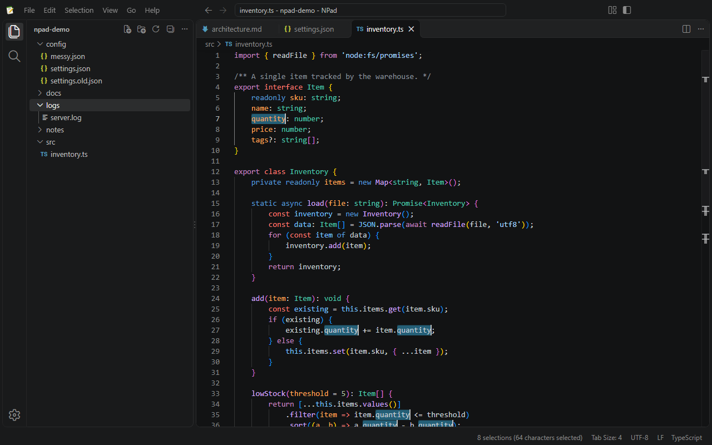
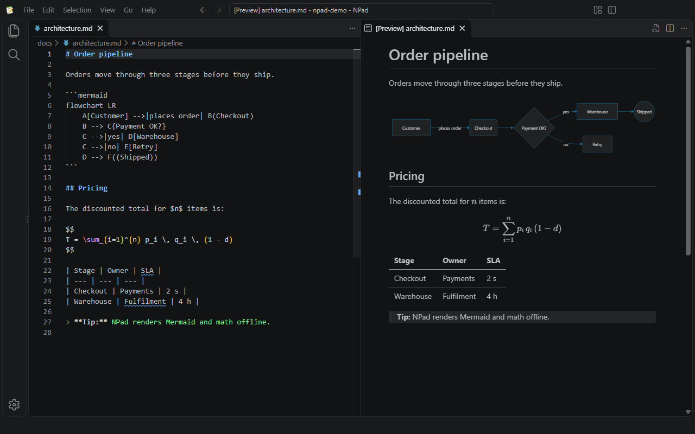
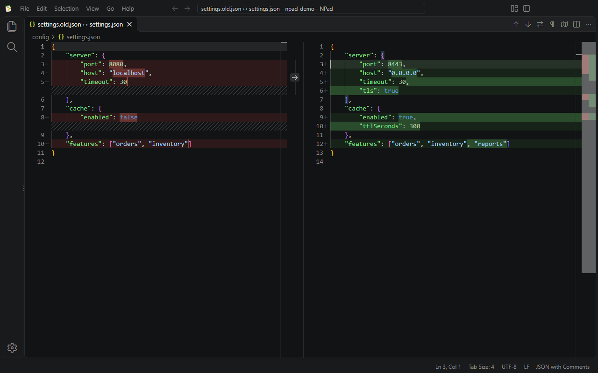
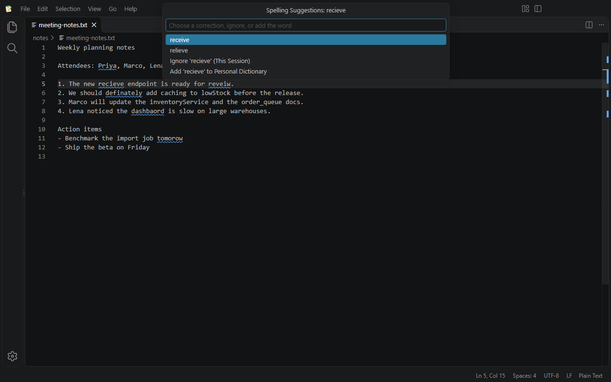
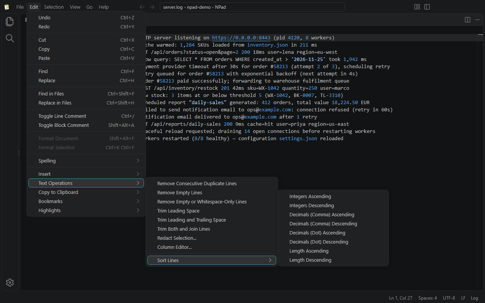
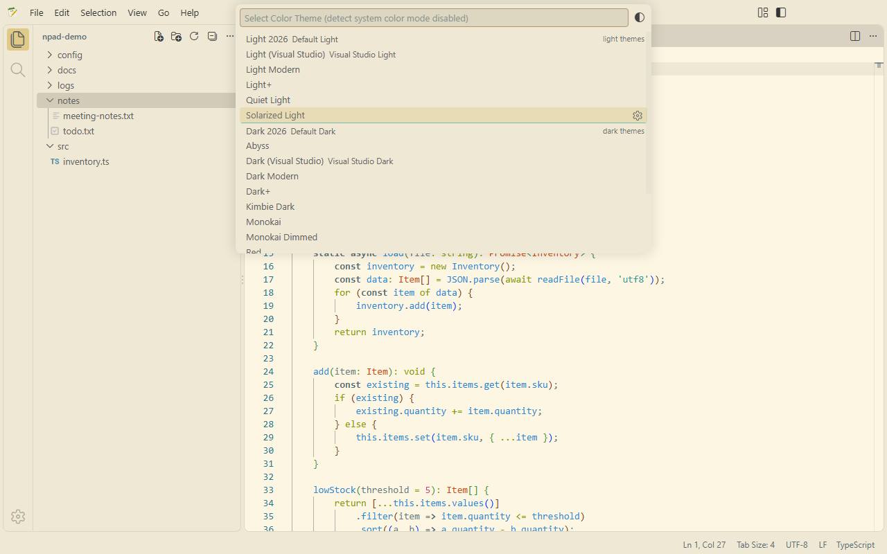

<p align="center">
  
</p>

<h1 align="center">NPad</h1>

<p align="center">
  <strong>Notepad simplicity. VS Code editing power.</strong><br>
  A fast, private, offline text editor built on the VS Code editing core.
</p>

<p align="center">
  <a href="https://github.com/sahitya0000/NPad/actions/workflows/ci.yml"></a>
  <a href="LICENSE"></a>
  
</p>

---

Sometimes you just want to open a file, fix it, and close it. NPad keeps the parts of VS Code that make editing great, including the editor, multi-cursor, find and replace, syntax highlighting, and Markdown preview. It drops the IDE: no terminals, debuggers, extensions marketplace, accounts, telemetry, or AI.



## ✨ Highlights

- ⚡ **Opens straight to typing.** You start in a blank tab, and opening a file replaces it.
- 🎨 **40+ languages and 12 themes** built in, with nothing to install.
- 📝 **Markdown preview** with Mermaid diagrams and math.
- 🧹 **JSON/JSONC formatter** that changes only whitespace. Numbers, key order, and comments stay as they are.
- 🔍 **Compare any two files** side by side.
- ✅ **Offline English spell check** for `.txt` and `.md` files, aware of `camelCase` and `snake_case`.
- 🧰 **54 editing tools:** bookmarks, colored highlights, numeric sort, column editing, Base64, date and Unicode insertion, `tail -f` log following, plain-text print, and more.
- 🔒 **Private by design.** No telemetry, sign-in, auto-updater, or network calls while you edit.

See the full [feature guide](docs/FEATURES.md).

## 📸 Take a tour

**Preview Markdown as you write.** Mermaid diagrams, math, and tables render side by side with the source, fully offline.



**Compare two files in seconds.** See exactly what changed between versions, down to the character.



**Catch typos in notes and docs.** Misspellings are underlined as you type. Press `Ctrl+.` to fix, ignore, or add the word.



**Reach for power tools when you need them.** Sort, trim, dedupe, redact, column-edit, bookmark, and highlight, all from the Edit menu.



**Make it yours.** Switch between 12 built-in light and dark themes instantly.



## 📦 Download

Grab the latest installer or archive from [**Releases**](https://github.com/sahitya0000/NPad/releases).

| Platform | Package | Status |
| --- | --- | --- |
| Windows x64 | Installer (`NPadSetup-x64-*.exe`) | ✅ Tested |
| Linux x64 | Portable `.tar.gz` | ✅ Tested |
| Linux ARM64, macOS (Intel / Apple Silicon) | `.tar.gz` / `.zip` | 🧪 Built in CI, needs real-device testing |

Builds are not code-signed yet, so your OS may show a warning before running them.

## 🛠️ Build from source

You need Node 24.22.1, pnpm 12.16.0, Python 3, and your platform's native C++ toolchain. Details are in the [contributor guide](CONTRIBUTING.md#build).

```sh
pnpm install --frozen-lockfile
pnpm run build-npad
```

The app is written to `.build/npad/<platform>-<arch>/`.

## 🚫 Not included (on purpose)

NPad has no AI/Copilot, terminal, debugger, source control, notebooks, tasks, remote development, extension marketplace, settings sync, multi-root workspaces, or telemetry. If you need those, use [VS Code](https://code.visualstudio.com/). Please don't open feature requests to add them back.

## 🤝 Contributing

Bug reports and focused pull requests are welcome. Start with [CONTRIBUTING.md](CONTRIBUTING.md). Report vulnerabilities privately as described in [SECURITY.md](SECURITY.md). Please follow the [code of conduct](CODE_OF_CONDUCT.md).

## 📄 License

[MIT](LICENSE) © Sahitya Patel.

NPad is an independent derivative of [Code - OSS](https://github.com/microsoft/vscode) and is not a Microsoft product. Upstream code keeps Microsoft's MIT notice in [LICENSE.txt](LICENSE.txt). Third-party notices are in [ThirdPartyNotices.txt](ThirdPartyNotices.txt).
